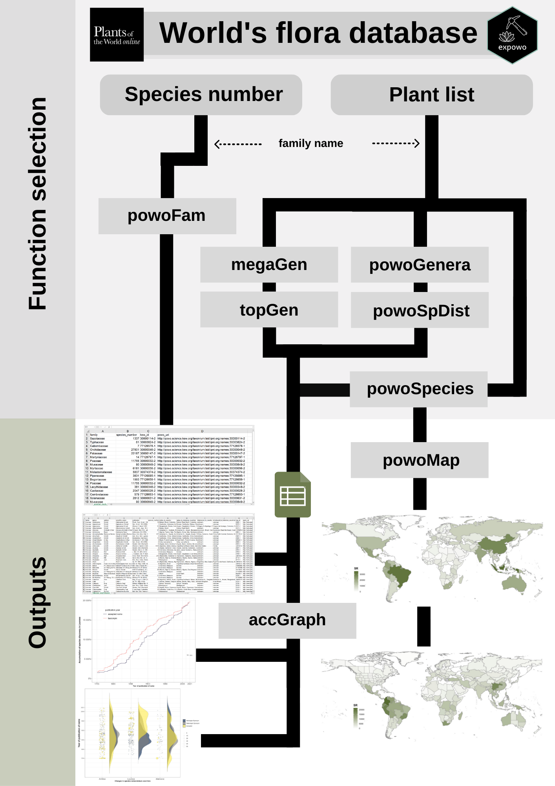
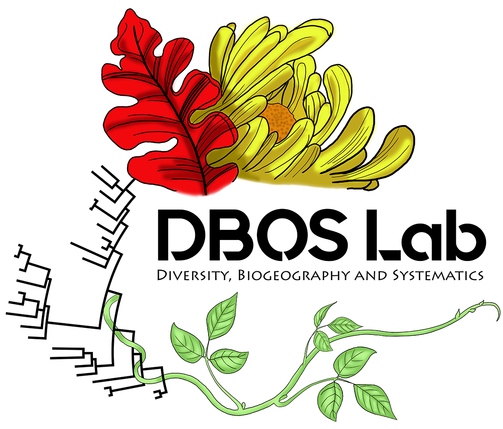

# expowo 

An R package for mining species list, diversity estimates, and
distribution data for any genus or family of vascular plants from the
World Checklist of Vascular Plants (WCVP) available through RBG Kew’s
Plants of the World Online (POWO).

## Overview

The main goal of the **expowo** package is to retrieve information about
the diversity and distribution of any plant family as publicly available
at the taxonomically verified database Plants of the World Online
(POWO). It can return a comma-separated values (CSV) file with the
number of accepted species and country-level distribution for any genus
as well as the full list of accepted species in any genus or family,
their authorship, original publication and global distribution. The
functions `powoMap` and `accGraph` can automatically create global maps
for any taxon level and accumulation graphics of species discovery,
respectively.

## Data source

Since version 3.2, the mining functions read by default the bulk data of
the [World Checklist of Vascular
Plants](https://powo.science.kew.org/about-wcvp) (WCVP), which is the
taxonomic backbone of POWO (`source = "wcvp"`). The WCVP file (about 90
MB) is downloaded from Kew only once, at the first search, and then
cached on disk at `tools::R_user_dir("expowo", "cache")`. It is
downloaded again only when Kew releases a new WCVP version, so any
following search runs in a few seconds, even for very large families.

The output tables keep exactly the same columns as the earlier versions
of **expowo**, in which the source HTML page of each taxon at POWO was
mined. That mining approach is still available with `source = "powo"`,
but it is much slower and the POWO website may block automated requests.

\
[`library`](https://rdrr.io/r/base/library.html)`(`[`expowo`](https://dboslab.github.io/expowo/)`)`\
\
`# Default: WCVP bulk data`\
[`powoSpecies`](https://dboslab.github.io/expowo/reference/powoSpecies.md)`(``family ``=`` ``"Martyniaceae"``,`\
`            synonyms ``=`` ``TRUE``,`\
`            country ``=`` `[`c`](https://rdrr.io/r/base/c.html)`(``"Argentina"``, ``"Brazil"``, ``"French Guiana"``)``)`\
\
`# Mining the POWO source pages of each taxon`\
[`powoSpecies`](https://dboslab.github.io/expowo/reference/powoSpecies.md)`(``family ``=`` ``"Martyniaceae"``,`\
`            source ``=`` ``"powo"``)`

## Before using **expowo**

#### Update R and RStudio versions

Please make sure you have installed the latest versions of both R ([Mac
OS](https://cran.r-project.org/bin/macosx/),
[Windows](https://cran.r-project.org/bin/windows/base/)) and RStudio
([Mac OS /
Windows](https://docs.posit.co/ide/user/#rstudio-ide-oss-downloads):
choose the free version).

## Installation

You can install **expowo** from
[CRAN](https://CRAN.R-project.org/package=expowo) by just running the
following R code:

\
[`install.packages`](https://rdrr.io/r/utils/install.packages.html)`(``"expowo"``)`

\
[`library`](https://rdrr.io/r/base/library.html)`(`[`expowo`](https://dboslab.github.io/expowo/)`)`

Otherwise, you can install the latest development version of **expowo**
from [GitHub](https://github.com/) using the
[devtools](https://github.com/r-lib/devtools) package with the following
R code:

\
[`install.packages`](https://rdrr.io/r/utils/install.packages.html)`(``"devtools"``)`\
`devtools``::`[`install_github`](https://rdrr.io/pkg/devtools/man/install-deprecated.html)`(``"DBOSlab/expowo"``)`

\
[`library`](https://rdrr.io/r/base/library.html)`(`[`expowo`](https://dboslab.github.io/expowo/)`)`

OBS.: To download the development version, you will need to have the
[Git](https://git-scm.com/) software installed. And if your operating
system is Microsoft Windows, you will also need to download the Rtools.

## Usage

The package’s major functions (`powoFam`, `powoGenera`, `powoSpecies`,
`powoSpDist`, `megaGen`, and `topGen`) only require the name of the
target family (or a vector with multiple family names). These major
functions work with other minor functions (`getInfo` and `saveCSV`),
with auxiliary and defensive functions to mine the plant data.
Respectively, `getInfo` mines the taxonomic information of each genus,
the total number of species within any genus, and does a complete search
for native and introduced country-level distribution for any genus and
species, while `saveCSV` fastly writes CSV files within the current date
subfolder of a provided specific directory. With these extracted
distributions, it is also possible to automatically generate global maps
according to political country and botanical countries with the function
`powoMap`. Additionally, if you want to plot new species discoveries
within any genus after downloading the data using `powoSpecies`, it is
also possible to do it automatically using `accGraph`. See the examples
on how to use the **expowo**’s functions for mining and using data
regarding the global plant diversity and distribution in the ‘Articles’
section in our [site](https://DBOSlab.github.io/expowo/).

## Documentation

A detailed description of the **expowo**’s full functionality is
available [here](https://DBOSlab.github.io/expowo/).

The **expowo** package is being continuously constructed. If you want to
make suggestions, let us know! We hope it will be helpful for your
botanical research!

## Citation

Zuanny, D. C., B. Vilela, P. W. Moonlight, T. E. Särkinen, and D.
Cardoso. 2024. expowo: An R package for mining global plant diversity
and distribution data. Applications in Plant Sciences 12: e11609.
<https://doi.org/10.1002/aps3.11609>

